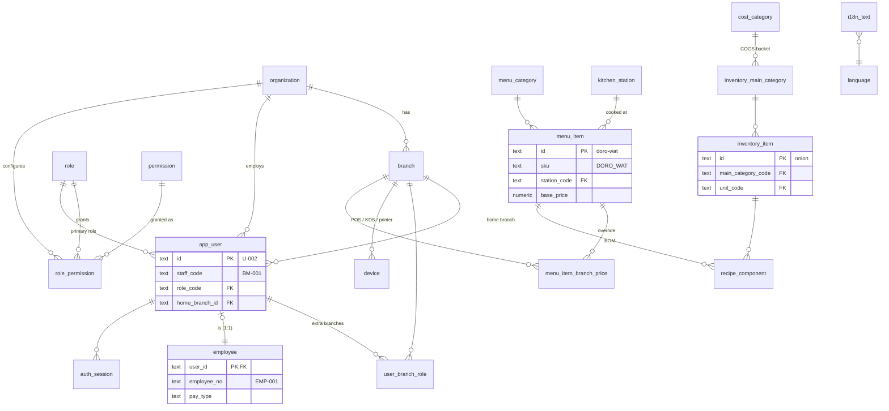
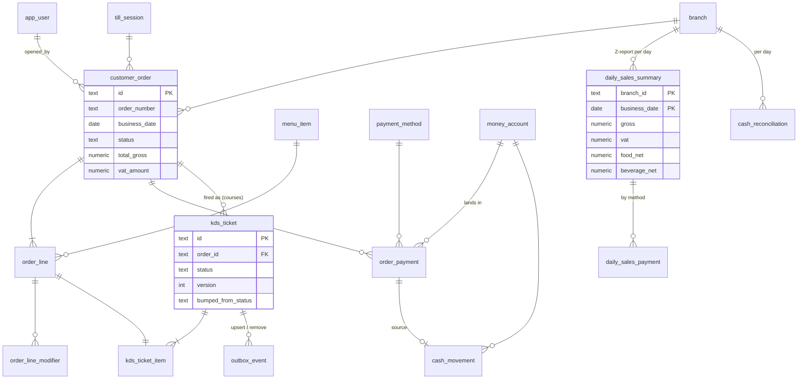
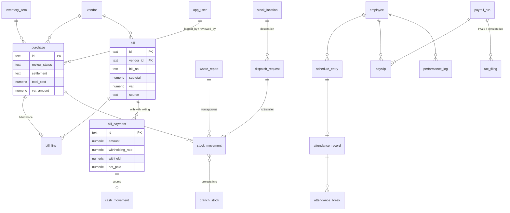
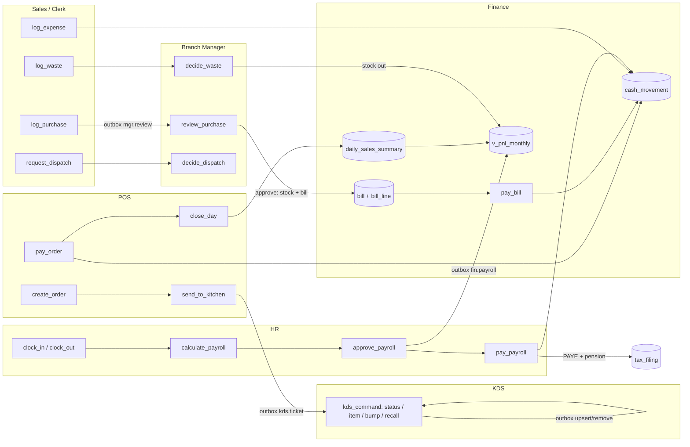

# SEER — unified backend architecture

One PostgreSQL database (SQLite build for laptops and offline caches), one API, seven frontends.
Everything here was checked against the code in the seven uploaded modules; the schema, seed import
and cross-module flows run and pass tests (see [§9](#9-what-was-verified)).

| | |
|---|---|
| Schema (source of truth) | `db/postgres/001_schema.sql` (66 tables) · `002_views.sql` (12 read models) |
| SQLite build | `db/sqlite/*` — generated by `db/tools/pg_to_sqlite.py` |
| Seed | `db/seed/{postgres,sqlite}/010_reference.sql`, `020_demo.sql`, `IMPORT_REPORT.md` |
| Services (the connection points) | `api/eirsha_api/services.py` |
| API | `api/eirsha_api/main.py` + `routes/*.py` (84 endpoints, FastAPI) |
| Tests | `tests/test_flows.py` (SQLite), `tests/pg_checks.sql` (PostgreSQL-only behaviour) |

---

## 0. What the code told us (read this first)

1. **`ffii-main` is not a POS.** Its package is `restaurant-owner-os`; `data.ts` is an owner
   dashboard (cash flow, budgets, Telebirr/Cash/CBE balances, top dishes, peak hours). No module
   creates orders today, yet the KDS expects tickets. The schema therefore includes full POS tables
   (`customer_order`, `order_line`, `order_payment`, `till_session`) and the API exposes `/orders`,
   ready for a POS screen. FFII becomes the **Owner** surface: read-only roll-ups plus `budget_line`.
2. **One person, five IDs.** Hanna Tesfaye is `U-002` (Admin), `EMP-001` (HR, Finance),
   `BM-001` (Manager), `u-hanna` (Sales). Branches differ (`BR-BOLE` vs `BR-BOLE-01`), menu IDs differ
   (`DORO_WAT` vs `doro-wat`), and Sales calls the manager role `MANAGER`. Canonical IDs are Admin's
   for people/branches and the kebab slugs for menu items; every other ID is kept in `legacy_id_map`.
3. **The demos disagree with each other** (prices, who manages Piassa, Dawit's role, food/beverage
   being *net of VAT* in Finance). `db/seed/IMPORT_REPORT.md` lists every conflict and the rule used.
4. Missing from all modules but needed to connect them: vendors as records (Sales typed free text),
   a stock ledger, a bill ↔ purchase link, POS payments, an outbox for realtime.

---

## 1. Schema by module

Each table's header comment in the SQL says who owns (writes) it and who reads it.

| Area | Tables | Owner → readers |
|---|---|---|
| Tenancy & i18n | `organization`, `language`, `i18n_text`, `branch` | ADMIN → all |
| Identity & access | `role`, `permission`, `role_permission`, `app_user`, `user_branch_role`, `device`, `auth_session`, `legacy_id_map` | ADMIN (+HR for people) → all |
| Shared reference | `payment_method`, `money_account`, `cost_category`, `inventory_main_category`, `expense_tag`, `waste_reason`, `unit`, `vendor`, `tax_rule`, `paye_bracket`, `shift_template`, `kitchen_station`, `menu_category` | ADMIN/FIN/HR → all |
| Catalogues | `menu_item`, `menu_item_branch_price`, `modifier`, `menu_item_modifier`, `recipe_component`, `inventory_item`, `inventory_item_alias`, `stock_location` | ADMIN (menu), SALES (stock items) → POS, KDS, MGR, FIN |
| Inventory & spend | `branch_stock`, `stock_movement`, `purchase`, `waste_report`, `dispatch_request`, `expense` | SALES → MGR review → FIN |
| POS & KDS | `till_session`, `customer_order`, `order_line`, `order_line_modifier`, `order_payment`, `kds_ticket`, `kds_ticket_item`, `outbox_event`, `idempotency_key` | POS → KDS, MGR, FIN, OWNER |
| Finance | `daily_sales_summary`, `daily_sales_payment`, `bill`, `bill_line`, `bill_payment`, `cash_movement`, `cash_reconciliation`, `tax_filing`, `budget_line` | FIN (OWNER for budgets) → MGR, OWNER |
| HR | `employee`, `schedule_entry`, `attendance_record`, `attendance_break`, `payroll_run`, `payslip`, `performance_log` | HR (MGR logs) → FIN, MGR |
| Admin | `receipt_config` | ADMIN → POS |
| Audit | `audit_log` (append-only) | every module → ADMIN, MGR |

**Conventions.** `snake_case`, singular tables. Text primary keys: the API mints prefixed ULIDs
(`pur_01J9…`); seed IDs (`BR-BOLE`, `doro-wat`, `V-03`) are kept verbatim so the frontends keep working.
Every tenant row has `org_id`; branch rows have `branch_id` with a **composite FK `(org_id, branch_id)`**
so a row can never point at another organisation's branch. Money `numeric(14,2)` ETB, quantities
`numeric(14,3)`, rates stored as fractions (`0.15`). Timestamps `timestamptz` (UTC); business dates are
`date` in Addis Ababa time. Fixed state machines are `CHECK`s; lists a business may extend
(categories, reasons, methods, roles) are lookup tables with an i18n key. Soft delete (`deleted_at`)
only where a UI deletes/restores (purchases, waste, expenses, users, vendors, items, menu).

**Read models (`002_views.sql`).** `v_branch_stock_status` (LOW STOCK), `v_branch_menu` (effective
branch price), `v_bill_status` (OPEN/PARTIAL/DUE_SOON/OVERDUE/PAID exactly as finance-main derives it),
`v_daily_payments`, `v_daily_sales_live`, `v_sale_line` (Manager's SaleLine), `v_manager_queue`,
`v_account_balance`, `v_pnl_monthly`, `v_vat_monthly`, `v_wht_monthly`, `v_user_permission`.

---

## 2. Entity-relationship overview

Key columns only. Every branch-scoped table also carries `org_id`.

### 2a. Identity, branches, catalogues



### 2b. Orders, kitchen, money



### 2c. Purchasing, stock, payables, HR



---

## 3. How data flows between modules

Each arrow is one function in `services.py`, one database transaction, one `audit_log` row and (where
another screen must react) one `outbox_event`.



| # | Flow | Rows written |
|---|---|---|
| 1 | **POS order → KDS ticket.** `create_order` prices lines from `v_branch_menu` (Admin's branch overrides), stores VAT-inclusive totals. `send_to_kitchen` fires every unsent active line as a `kds_ticket` (later courses become ticket `042-2`) and emits `{type:"upsert", ticket}` in the KDS's own `KitchenTicket` shape. | `customer_order`, `order_line`, `order_line_modifier`, `kds_ticket`, `kds_ticket_item`, `outbox_event`, `audit_log` |
| 2 | **KDS commands.** `status`/`item`/`bump`/`recall` follow kitchen-display's demo-feed rules exactly (READY completes all items and freezes the timer; bump → `remove`; recall restores the pre-bump status). `version` gives optimistic locking across screens; `Idempotency-Key` makes retries safe. | `kds_ticket(_item)`, `idempotency_key`, `outbox_event`, `audit_log` |
| 3 | **Void after send → HR.** `void_line` updates the KDS ticket and, if the kitchen already had it, writes a `performance_log` `VOID_INCIDENT` for the server — the link HR-main models as `source: MANAGER_MODULE`. | `order_line`, `kds_ticket_item`, `performance_log` |
| 4 | **Payment → cash.** `pay_order` (split tender; Telebirr/CBE Birr need a transaction reference) writes a `cash_movement` into the branch drawer or the org wallet. | `order_payment`, `cash_movement` |
| 5 | **Day close → Finance.** `close_day` freezes `v_daily_sales_live` into `daily_sales_summary` (gross, VAT, food/beverage **net**, by method), opens `cash_reconciliation` with expected cash/Telebirr/CBE Birr. Finance's `DailySales[]` and the P&L read only closed days. | `daily_sales_summary`, `daily_sales_payment`, `cash_reconciliation` |
| 6 | **Purchase → review → payable.** Clerk logs (`PENDING`; if paid now, the cash movement is written immediately). Manager approves: stock in at moving-average cost, a `bill` + `bill_line.purchase_id` is created (due date from vendor terms), and if it was paid on the spot a matching `bill_payment`. FLAG/REJECT need a reason. | `purchase`, `stock_movement`, `branch_stock`, `bill`, `bill_line`, `bill_payment` |
| 7 | **Bill payment with withholding.** `pay_bill` applies finance-main's rule: 0 below the threshold (goods 20 000 / services 10 000), 3 % with TIN, 30 % without; only the net leaves the account. | `bill_payment`, `cash_movement`, `v_wht_monthly` |
| 8 | **Waste / dispatch.** Approval moves stock (`WASTE`, `DISPATCH`, `TRANSFER_OUT` → `TRANSFER_IN` at the receiving branch) and raises `stock.low` when an item crosses its reorder point. | `stock_movement`, `branch_stock`, `outbox_event` |
| 9 | **HR → Finance.** Clock-in matches the planned shift, records lateness (grace 5 min) and a `LATENESS` log; clock-out computes overtime and the 1.5 / 1.75 (after 22:00) / 2.0 (Sunday) multiplier. `calculate_payroll` is a line-by-line port of HR-main's `payslip()` (PAYE brackets of Proclamation 1395/2025, 7 %/11 % pension). Paying a run moves net pay out of the bank and opens PAYE and pension `tax_filing`s; the P&L takes gross + employer pension. | `attendance_record`, `payslip`, `payroll_run`, `cash_movement`, `tax_filing` |
| 10 | **Everything → audit.** One vocabulary, `"<entity>.<verb>"`, covering Sales (`CREATE WASTE` → `waste_report.create`), Manager (`FLAG_PURCHASE` → `purchase.flag`), Admin (`PRICE` → `menu_item.price_change`), KDS (`kds_ticket.bump`). `summary_template` + `vars` mirror Admin's entries so each UI re-renders them in en/am/om. | `audit_log` |

**P&L composition (`v_pnl_monthly`).** Revenue = closed Z-reports, net of VAT. COGS/OPEX = bill lines by
issue date (accrual), plus approved purchases not yet on a bill, plus expenses (not rejected). Waste =
approved waste at cost. Payroll = gross + employer pension of approved/paid runs. A purchase is never
counted twice: once it is on a bill, only the bill line counts.

---

## 4. API surface (replaces each frontend's `store.ts`)

All routes need `Authorization: Bearer …` and (for branch work) `X-Branch-Id`. Guards are permission
codes (see §6). Response bodies keep the frontends' existing field names where a shape already exists
(KDS `KitchenTicket`, Finance `DailySales`, Sales `PeriodTotals`, Manager `PaymentSummary`, FFII
`MonthPoint`).

| Frontend | Today (local store) | Endpoint |
|---|---|---|
| **all** | sign-in lists in `catalog.ts` | `POST /auth/login` · `POST /auth/pin` (device + staff code + PIN) · `POST /auth/refresh` · `POST /auth/logout` · `POST /auth/password` (change own) · `GET /auth/me` |
| **all** | `catalog.ts` lists, `registerText()` | `GET /ref/bootstrap` · `GET /ref/i18n/{en\|am\|om}` |
| **Sales** | `BASE_INVENTORY`, custom items | `GET /inventory/items?q=` · `POST /inventory/items` |
| | purchases | `POST /purchases` · `GET /purchases?period=&status=` · `DELETE /purchases/{id}` · `POST /purchases/{id}/restore` |
| | waste, expenses | `POST /waste` · `GET /waste` · `POST /expenses` · `GET /expenses` |
| | dashboard | `GET /sales/dashboard?period=today\|7d\|30d` |
| | dispatch request | `POST /dispatch` |
| **Manager** | overview (shift-aware) | `GET /manager/overview?period=&shift=` |
| | review queues | `GET /manager/queue` · `POST /manager/purchases/{id}/review` · `POST /manager/waste/{id}/decision` · `POST /manager/expenses/{id}/review` |
| | dispatch | `GET /manager/dispatch?status=` · `POST /manager/dispatch/{id}/decision` · `POST /manager/dispatch/{id}/receive` |
| | sales & reconciliation | `GET /manager/sales?period=` · `GET /manager/reconciliation/{day}` · `GET /manager/audit` |
| **POS** (`apps/cashier`) | `data.ts` menu, `charge()` stub | `GET /pos/menu` · `POST /orders` (`sendNow`) · `POST /orders/{id}/lines` · `POST /orders/{id}/send` · `POST /orders/{id}/payments` · `POST /orders/{id}/cancel` (unpaid, unsent) · `POST /order-lines/{id}/void` · `GET /orders` · `POST /pos/day-close` |
| **KDS** | `feed/demo.ts` | `WS /ws?branch=&token=&topics=kds.ticket` · `GET /kds/tickets` · `POST /kds/tickets/{id}/status\|item\|bump\|recall` — identical to `feed/live.ts` |
| **Finance** | Z-reports, bills, tax, cash | `GET /finance/daily-sales?frm=&to=` · `GET/POST /finance/vendors` · `GET/POST /finance/bills` · `POST /finance/bills/{id}/payments` · `GET /finance/pnl` · `GET /finance/tax` · `POST /finance/tax-filings/{id}/file` · `GET /finance/cash` · `PUT /finance/reconciliations/{branch}/{day}` · `GET /finance/payroll-journal` |
| **HR** | employees, schedule, attendance, payroll, logs | `GET/POST /hr/employees` · `GET/POST /hr/schedule` · `POST /hr/attendance/clock-in\|clock-out` · `POST /hr/attendance/{id}/breaks` · `GET /hr/attendance?date=` · `POST /hr/payroll/{month}/calculate` · `POST /hr/payroll/runs/{id}/approve\|pay` · `GET/POST /hr/performance-logs` |
| **Admin** (`apps/admin`, live) | profile, branches, users, matrix, receipt, prices, audit | `GET /admin/bootstrap` (everything, in the app's own shapes) · `GET/PUT /admin/store-profile` · `GET/POST /admin/branches` · `PUT /admin/branches/{id}` · `GET/POST /admin/users` · `PUT /admin/users/{id}` (edit, (de)activate, set password) · `PUT /admin/receipt` (all branches) · `POST /admin/exports/log` · `GET /admin/permissions` · `PUT /admin/permissions/{role}/{code}?granted=` · `PUT /admin/menu-prices/{item}` · `PUT /admin/receipt/{branch}` · `GET /admin/audit` · `GET /admin/exports/transactions.csv` |
| **Owner (FFII)** | `data.ts` | `GET /owner/cash-flow?year=` · `GET /owner/balances` · `GET /owner/top-dishes` · `GET /owner/peak-hours` · `GET/PUT /owner/budgets/{month}` |

**Realtime topics** (outbox → WebSocket): `kds.ticket` (KDS wire format), `mgr.review` (Manager queue
refresh), `mgr.sales`, `stock.low`, `fin.zreport`, `fin.payables`, `fin.payroll`. On PostgreSQL the
relay wakes on `LISTEN eirsha_outbox` and also polls every second; on SQLite it polls. Delivery is
at-least-once; the KDS gets a fresh snapshot on every (re)connect, so a missed event heals itself.

**Errors.** `ServiceError` → JSON `{error, …detail}` with 404 / 409 (state conflict, stale KDS version)
/ 422 (validation). The KDS's live feed already treats 4xx as "roll back" and retries 5xx.

---

## 5. Migration & seed strategy

**Bootstrap a new install**

```bash
make sqlite-schema                     # only after editing db/postgres/*.sql
make seed FRONTENDS=../frontends       # run each frontend's own generateSeed() → JSON → SQL
make pg-load PG=postgresql:///eirsha   # schema → views → 010_reference → 020_demo (optional)
make test
```

1. **Reference vs demo.** `010_reference.sql` is what every install needs: languages and 273 i18n keys
   merged from all modules, roles/permissions, the organisation, branches, all 29 people (merged),
   payment methods, cost categories, units, stations, vendors, tax rules, PAYE brackets, menu with
   branch prices, inventory catalogue, stock locations, employees and `legacy_id_map`.
   `020_demo.sql` is history from the demos (purchases, waste, 2 082 historic orders plus 6 live KDS tickets, bills, Z-reports, attendance,
   audit…). Skip it in production.
2. **The seed comes from the frontends themselves.** `seed/node/export-frontends.mjs` imports each
   module's `catalog.ts`/`seed.ts` with plain Node 22 and calls its own `generateSeed()`, so the JSON is
   exactly what each local store holds today. `seed/build_seed.py` maps it onto the unified schema and
   writes `IMPORT_REPORT.md` (identity merges, conflicts, missing translations). Re-run it whenever a
   frontend's seed changes.
3. **Keeping the existing shapes working.** Migrate one frontend at a time: replace the body of each
   `store.ts` function with a call to the matching endpoint and keep the TypeScript types. Legacy IDs
   still resolve: the seed keeps Admin/menu/vendor/inventory IDs verbatim, and `legacy_id_map` answers
   `('MGR','user','SS-104') → U-…`. During the transition the API can accept either form by looking
   the ID up there.
4. **Suggested order:** Admin (owns people, branches, prices) → HR (same people) → Sales → Manager →
   Finance → POS + KDS (switch `feed/index.ts` to `LiveOrderFeed`) → Owner.
5. **Offline tablets.** Every create endpoint takes a `clientRef`; a unique index makes replays
   return the first row instead of a duplicate — safe for spotty connectivity at the branch.
6. **Schema changes.** Treat `db/postgres/001_schema.sql` as the baseline; add numbered migration files
   after it (`003_…sql`), regenerate the SQLite build, re-run tests. Adopt Alembic or sqitch once the
   first production database exists.

---

## 6. Auth model

**People.** One `app_user` per person; `employee` is a 1:1 HR extension. Back-office users sign in
with username + password; floor staff use their printed staff code (`SS-104`) + PIN on a **registered
device** (`POST /auth/pin` with `X-Device-Id`/`X-Device-Secret`). Secrets are PHC-format hashes
(scrypt in this code; argon2id is a drop-in). Access JWT 15 min; refresh session in `auth_session`
(14 days; 12 h for PIN sessions on shared terminals). Every sign-in/out is audited.

**Roles.** The five existing roles map 1:1; three optional org-level roles cover screens that had no
role of their own.

| Role (`role.code`) | Scope | Was called | Typical surfaces |
|---|---|---|---|
| `ADMIN` | ORG | `ADMIN` everywhere | System Admin: Admin app, every app except the Owner app; created only by the Owner |
| `BRANCH_MANAGER` | BRANCH | `MANAGER` in sales-main | Manager, Sales, HR (own branch), reconciliation |
| `SALES_STAFF` | BRANCH | same | POS, dispatch requests, own clock-in |
| `KITCHEN_STAFF` | BRANCH | same (HR, Admin, KDS) | KDS, waste, dispatch requests |
| `INVENTORY_CLERK` | BRANCH | same | Sales module, dispatch |
| `ACCOUNTANT` *(new)* | ORG | Finance's "Accountant" (Mahlet Assefa) | Finance |
| `HR_OFFICER` *(new)* | ORG | — | HR |
| `OWNER` *(new)* | ORG | FFII owner | Owner app (Owner only), System Admin accounts, everything a System Admin can do |

**Permissions.** 42 codes, `"<area>.<action>"`. Admin's nine matrix booleans are codes with a
`legacy_flag`, so the Access screen keeps working unchanged:

| Admin flag | Code | | Admin flag | Code |
|---|---|---|---|---|
| canViewReports | `report.view` | | canMakeSales | `pos.sell` |
| canApproveDispatch | `dispatch.approve` | | canRequestDispatch | `dispatch.request` |
| canEditPrices | `menu.price_edit` | | canLogExpenses | `expense.log` |
| canLogWaste | `waste.log` | | canOverrideInventory | `stock.adjust` |
| canAccessAdmin | `admin.access` | | | |

The other codes cover what the modules gate in code today (`purchase.review`, `waste.approve`,
`record.delete`, `kds.update`, `pos.void`, `pos.day_close`, `fin.bill_pay`, `fin.tax_file`,
`hr.payroll_approve`, `owner.budget_edit`, …). `role_permission` is per organisation, seeded from
Admin's `DEFAULT_PERMISSIONS` plus each module's own role checks.

**Branch scope.** `v_user_permission` = primary role at the home branch ∪ `user_branch_role` rows
(dated). A request's `X-Branch-Id` must be one the user holds a role at, unless the role is ORG-scoped.
Every service also re-checks the row's branch (e.g. a KDS screen cannot bump another branch's ticket).

**Tenant isolation.** PostgreSQL row-level security on the business tables:
`org_id = current_setting('eirsha.org_id')`, set per transaction by the API. The app connects as a
non-owner role (`eirsha_app`) with `UPDATE/DELETE` revoked on `audit_log`, which a trigger also
makes append-only.

---

## 7. Ethiopian specifics

| Rule | Where |
|---|---|
| VAT 15 %, prices VAT-inclusive at the register: `vat = gross × 0.15 / 1.15` | `organization.vat_rate`, `order_line.vat_rate` snapshot, `tax_rule VAT`, `v_vat_monthly` |
| Input VAT deductible only with a receipt | `bill.has_vat_receipt`, `purchase.has_vat_receipt` |
| Withholding 3 % (TIN) / 30 % (no TIN), thresholds 20 000 goods / 10 000 services | `tax_rule WHT_*`, `vendor.tin_number`, `vendor.supply_kind`, `bill_payment.withheld` |
| PAYE brackets (Proclamation 1395/2025), pension 7 % + 11 % | `paye_bracket`, `tax_rule PENSION_*`, `payslip` |
| Overtime 1.5 / 1.75 night / 2.0 rest day (Labour Proclamation 1156/2019) | `attendance_record.overtime_multiplier` |
| Cash, Telebirr, CBE Birr (+ CBE bank for deposits) | `payment_method`, `money_account`, `order_payment.reference` unique per method |
| TIN, VAT number, trade licence on receipts | `organization`, `receipt_config.show_tin` |
| English / Amharic / Afaan Oromo | `language`, `i18n_text` (platform + per-org overrides), `app_user.preferred_language`, `*.name_key` everywhere |
| Orthodox fasting menu | `menu_item.is_fasting`, `menu_category FASTING` |
| Addis Ababa business day | `business_date` columns; Ethiopian-calendar display stays in the UI |

Rates and thresholds are dated rows, not constants, so a new proclamation is an `INSERT` with a
`valid_from`. Confirm the legal references with your accountant (the seed labels are best-effort).

---

## 8. Growing into a B2B platform

Already in place: `organization` as the tenant with RLS, composite branch FKs, per-org permissions and
translations, devices, an outbox for integrations, idempotent writes, dated tax rules.
Next steps when needed: `purchase_order` (multi-line, sent to vendors) in front of `purchase`; a vendor
portal reading `bill`/`bill_payment` for its own `vendor_id`; `recipe_component` for theoretical vs
actual food cost; partition `audit_log`, `outbox_event`, `stock_movement` by month; ERCA/MoR e-invoice
fields on `customer_order`; a plan/billing table per organisation.

---

## 9. What was verified

| Check | Result |
|---|---|
| PostgreSQL 16: schema + views + reference + demo seed load with `ON_ERROR_STOP` | ✓ 66 tables, 12 views, ~15 000 rows |
| SQLite: same files (generated) load with `PRAGMA foreign_keys=ON` and `foreign_key_check` clean | ✓ |
| `tests/test_flows.py` (SQLite, services) — POS→KDS→Z-report, purchase→review→bill→withholding, waste/dispatch/transfer/expense, attendance→payroll→Finance, permissions & legacy identity | ✓ 5/5 |
| `tests/pg_checks.sql` — `updated_at` triggers, append-only audit, KDS `version`, business CHECKs, RLS isolation, outbox `NOTIFY` | ✓ |
| All 40 GET routes + key POST routes called against the demo database with a real login | ✓ |

Not verified here: the Python service layer *through psycopg on PostgreSQL* (no PostgreSQL driver was
available in the build environment — the SQL is portable and parameter casts are explicit; run
`make test-pg` before go-live), and FastAPI itself (routes were exercised through a stand-in; install
`api/requirements.txt`, start uvicorn and open `/docs`).
